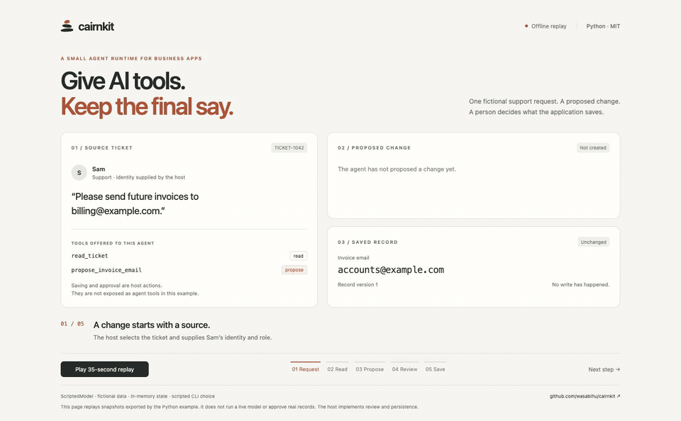

# cairnkit

[](https://github.com/wasabihu/cairnkit/actions/workflows/ci.yml)
[](LICENSE)


**A small agent runtime for business applications.** Give an agent useful tools while
keeping identity, permissions and persistence in your application. Use proposal tools
and a host-controlled review step when a person should decide what gets saved.

A cairn is a pile of stones that marks a trail so the next walker can follow it. cairnkit
does the same for agents: approved memory, searchable history and curated skills that the
next conversation builds on.

[中文说明](README.zh-CN.md)

## See the approval boundary

A fictional support ticket asks to change an invoice email. The agent reads it and
creates a draft. The saved record changes only after the host's reviewer approves it.
Rejecting the draft leaves the record untouched.



[Watch the 35-second walkthrough](docs/assets/cairnkit-approval-demo.mp4) ·
[Run the example and choose approve or reject](docs/approval-demo.md)

```bash
git clone https://github.com/wasabihu/cairnkit.git
cd cairnkit
uv run python examples/approval.py
```

**Offline, fictional data, no API key.** The model uses predetermined `ScriptedModel`
responses. The video replays snapshots from a real execution of that example, including
a scripted approval choice. It demonstrates the host integration, not model quality.
The in-memory review function is example application code, not a built-in approval service.

## Why another agent runtime

In a business application, several people may share records, each with different roles.
The application needs to retain control over which tools an agent can use and when a
proposed change becomes a saved record. cairnkit provides building blocks for that:

- **Identity comes from the host, never from the model.** Tools receive the signed-in
  person, their roles and the record being worked on in a `ToolContext`.
- **Make changes reviewable.** Tools declare an access level (`read`, `propose`, `write`)
  and allowed roles. Your proposal handler creates drafts; your application implements
  approval and persistence. The access label alone does not enforce human review.
- **Memory with guard rails.** Add / patch / remove edits located by quoted text, size
  limits, prompt-injection scanning and frozen snapshots, ported from Hermes Agent.
- **Compact long conversations.** A port of Hermes Agent's context compression:
  incremental structured summaries, real token anchors, cooldowns and verbatim user quotes.
- **Small.** The core depends only on the standard library and `httpx`. No web framework,
  no database, no vector store: storage and permissions stay in your application. The
  optional `knowledge` module adds document search on SQLite (standard library) and,
  if you want it, local vector search; the database file is still yours.

## What is inside

| Area                 | Module                       | What it does                                                                                                   |
| -------------------- | ---------------------------- | -------------------------------------------------------------------------------------------------------------- |
| Agent loop           | `loop.py`                    | Model → tools → model, streaming, a forced plain answer when the step budget runs out                          |
| Tools                | `tools.py`                   | Schema, handler, access level, allowed roles; identity is injected, never taken from the model                 |
| Loop protection      | `guardrails.py`              | Warns or stops on repeated failing calls and identical results                                                 |
| System prompt        | `prompt.py`                  | Stable / context / volatile layers, assembled once per conversation for prompt caching                         |
| Memory               | `memory.py`, `memory_ops.py` | Hermes' add / patch / remove rules; your store decides whether changes need approval                           |
| History search       | `search.py`                  | One tool, four modes (search, read, context, browse); no model calls                                           |
| Skills               | `skills.py`                  | `SKILL.md` folders, shown on demand, scanned for injection when loaded                                         |
| Context compression  | `compression.py`             | Four-phase compaction with incremental summaries and per-conversation `CompressionState`                       |
| Background review    | `review.py`                  | After a turn, a forked agent decides whether anything should be remembered                                     |
| Delegation           | `delegate.py`                | Hand a focused task to a specialist agent and get back only its answer (one level deep)                        |
| Skill curation       | `curator.py`                 | Marks unused skills stale, suggests archives and merges; returns a plan, you decide                            |
| Injection scanning   | `security.py`                | Prompt injection, hidden characters and exfiltration patterns                                                  |
| Titles               | `titles.py`                  | Instant title, upgraded by a small model; never overrides a title the user typed                               |
| Models               | `llm/`                       | OpenAI-compatible client (streaming), OpenRouter, error classification, fallback chain, offline scripted model |
| Cost                 | `pricing.py`                 | Uses the provider's reported cost, otherwise a price table                                                     |
| Agent definitions    | `agents.py`                  | One folder per agent: `agent.toml` + `SOUL.md`                                                                 |
| Documents (optional) | `documents.py`               | PDF, Word, Excel and text to Markdown, with size and zip-bomb limits                                           |
| Knowledge (optional) | `knowledge/`                 | Searchable documents in SQLite: chunks by heading, English and Chinese keyword search, optional local vectors, scope filters, retrieval evaluation ([design](docs/knowledge-design.md)) |

## Install

```bash
pip install cairnkit
# or
uv add cairnkit
# with document reading (adds pypdf and openpyxl):
pip install "cairnkit[documents]"   # or: uv add "cairnkit[documents]"
# with vector search for the knowledge module (adds sqlite-vec and fastembed):
pip install "cairnkit[vectors]"
```

Python 3.12 or newer.

## Quick start

An agent is a folder:

```
agents/
  greeter/
    agent.toml
    SOUL.md
```

```toml
# agents/greeter/agent.toml
description = "Answers questions about opening hours."
model = "default"          # a name your application maps to a model
tools = ["opening_hours"]  # the only tools this agent may use
skills = []                # optional: skills from a skills/ folder
max_iterations = 4
temperature = 0.2
```

`SOUL.md` holds the persona and rules; it goes into the stable layer of the system prompt.

```python
from cairnkit import Agent, ToolContext, ToolRegistry, load_agents, openrouter, tool_result

tools = ToolRegistry()

@tools.tool(name="opening_hours", description="Opening hours for a weekday.",
            parameters={"type": "object", "properties": {"day": {"type": "string"}},
                        "required": ["day"]})
def opening_hours(args, ctx):
    return tool_result(day=args["day"], hours="7am-7pm")

specs = load_agents("agents")
agent = Agent(specs["greeter"], model=openrouter("openai/gpt-4.1-mini", api_key="..."),
              tools=tools)
result = await agent.run("When do you open on Sunday?", ToolContext(principal={"id": "u1"}))
print(result.text)
```

Runnable examples, no API key needed:

| Example                                                | Shows                                                      |
| ------------------------------------------------------ | ---------------------------------------------------------- |
| [examples/minimal.py](examples/minimal.py)             | The smallest complete agent with one tool                  |
| [examples/approval.py](examples/approval.py)           | Read a ticket, propose a change, approve or reject in the host |
| [examples/read_document.py](examples/read_document.py) | Reading a PDF, Word or Excel file into Markdown            |
| [examples/knowledge.py](examples/knowledge.py)         | Search a fictional English and Chinese handbook and print the retrieval report (`--vectors` adds local embeddings) |
| [examples/verify_citations.py](examples/verify_citations.py) | A read tool that checks a draft's DOIs and PMIDs with [claimcite](https://github.com/wasabihu/claimcite) before review (needs network: `uv run --with claimcite python examples/verify_citations.py`) |

## Rules worth keeping

- **Identity is not the model's to decide.** Put the user and the record in `ToolContext`.
- **Assemble the system prompt once per conversation.** Pass `RunResult.system_prompt` back
  as `run(system_prompt=...)` on later turns so the provider's prompt cache keeps working.
- **Prefer `access="propose"`** for anything that changes data, and let a person approve.
- **Test offline** with `ScriptedModel`; automated tests should never call a real model.
- **Text from users, files and tools is data.** Keep it out of the system prompt.

## Memory consolidation and retrieval

```python
from cairnkit.memory_consolidation import consolidate_memory

result = await consolidate_memory(model, entries, pending_operations, limit=12000, target_chars=8000,
                                  validate=validate_grounding)
if result.plan is not None:
    # Host must atomically compare the original snapshot, then commit and audit.
    commit_if_unchanged(entries, result.plan)
```

A fitting batch makes no model request. Overflow permits up to three JSON
proposals with validation feedback. No proposal writes storage; failure or
cancellation leaves the original entries untouched. The host defines factual
support, which new corrections must survive, permissions and persistence.

`target_chars` is a soft consolidation goal. Only exceeding `limit` can invoke the
model. Up to three proposals try to reach the target; otherwise the smallest
host-validated plan under the hard limit is returned with `target_met=False`.
Indexed removals reduce output size for large sets of short entries.


For hosts with a verifiable fact vocabulary, pass `render_group: Callable[[list[str]], str]`.
The model then selects `{"groups":[[0,1]],"remove_ranges":[[2,4]]}` against a numbered,
pending-applied snapshot. Ranges are inclusive; unselected rows stay unchanged. IDs are
immutable across attempts. New/changed entries cannot be removed by a range; grouping
must retain their meaning, checked by the host's `validate` callback. The pure renderer
must preserve meaning or raise `ValueError` (e.g. when dates cannot be grouped).
The generic package supplies no domain vocabulary or permission decisions.

Selection proposals use a 2048-token output ceiling, explicit entry counts and remaining
space. `finish_reason=length` is rejected even for parseable JSON. Rejected output is not
replayed; each request sees the same snapshot and bounded feedback. A small, valid proposal
that misses the soft target may be included in feedback, explicitly not committed.
Legacy text `operations`/`remove_indices` remain accepted for compatibility and still pass
host validation; legacy callers without a renderer retain the 8192-token ceiling.
Explicit removals cannot leave less than 95% of `target_chars` (rounded down to whole
characters, at least one). This guard is based on the configured target, not a fixed
memory size. Host-rendered lossless groups and the lossless prepass can shrink further.
For legacy text patches, the host must compare meanings; it can call
`cairnkit.memory_selection.validate_removal_size(plan, target)` when facts were lost.
Legacy explicit removals are checked by the helper as well. A safe plan slightly above
the target remains preferable to excessive deletion and may be returned after three tries.
After a failed proposal listing every entry as a singleton group or deleting too much, the next request can
offer a calculated removal option. It takes entries in the supplied order and skips
protected changes and indivisible entries that would undershoot the allowed size.
If no bounded option exists, no option is offered. The model sees the facts the option would remove and can select or
decline it. The same host validator checks an accepted option before it becomes a plan.
Only final changes are returned for atomic persistence; no transient pending row needs to
be inserted and deleted. No provider errors are retried, and there are at most three
proposals. These are offline-tested mechanisms, not a guarantee of real-model quality.

Pass an optional `compact_entries: Callable[[list[str]], list[str]]` to try a lossless
prepass before model proposals. It receives a copy of the pending-applied entries and
must preserve every distinct fact (including new corrections), using only reversible
normalization and equivalent-fact deduplication. It must not drop less important facts.
The helper checks shape, non-growing size and the host's `validate`; only the host can
prove semantic equivalence. A fitting result returns `precompacted=True`, `attempts=0`,
even above `target_chars`. A result still over the hard limit is not partly committed;
model proposals use the original snapshot and IDs. Exceptions fail without writes.

For read-time context, hosts can pass individual facts as `MemoryItem`s in their chosen
priority order to `render_snapshot`. Each fact may carry its own source label. Packing
skips oversized items and repeated IDs; `max_items` counts only included items. Text
deduplication, relevance, source validation and ownership stay with the host. This does
not rewrite stored records or add a model request.

### Ordinal memory layers

`cairnkit.memory_layers.layer_facts` ranks original `LayeredFact` records by a
host-supplied stable source order. `recent_count` and `middle_count` are required
configuration, not day thresholds. The host owns topic keys, durable/pending
protection and reversible rendering. Unknown origins stay detailed and protected;
rebuilding summary rows does not reset source order. `MemoryLayers.compact` groups
older facts within the same topic and layer, with a default maximum of 16 atoms
per group. The host must validate exact semantic preservation.

`consolidate_memory(..., protected_entry=...)` exposes host protection in selection
IDs and bounded removal options. Supply `validate` too, including checks on legacy
text patches. No framework, database, business vocabulary or model prompt assembly
is imported by this module.

### Infeasible memory and bounded proposals

`consolidate_memory(..., minimum_chars=callback)` accepts a host-proven lower bound
on the pending-applied snapshot. A bound above the hard limit returns
`capacity_unreachable` with zero model attempts. Do not pass an estimate or assume
protected entries cannot be merged. Unknown feasibility keeps normal planning.
The host owns any separate correction-only transaction; this helper never writes storage.

Selection replies are limited to 16 groups of 16 IDs and 64 removal ranges, leaving
unselected entries unchanged. A truncated selection switches to an existing safe
removal option with a 128-token vote; if no safe option exists (or the vote truncates),
stop. No partial JSON is applied, no repeated long-output retry, no automatic deletion.

### Working summaries over a searchable archive

`cairnkit.memory_archive.project_archive` is a pure, optional projection. It accepts
`ArchiveFact(key, text, order, topic, keep_detail)` records, explicit character and
rank thresholds, and a host `summarize(facts, level)` callback. The result partitions
all input keys into detailed keys and typed summary groups; it never edits or deletes
canonical records. Archive keys remain available for scoped, bounded host retrieval.

When the full representation exceeds `limit`, older eligible facts are grouped until
`target` fits, trying distant then middle ranks. Recent, durable/explicitly protected,
unknown-origin and ungroupable facts remain detailed. If only an under-limit result
is possible it is returned; otherwise `capacity_unreachable` leaves input untouched.
A rebuilding summary never changes original source order. Character counts include
`ENTRY_DELIMITER`; host metadata and chat context budgets are separate.

Hosts must retain all canonical facts, validate topic/summary semantics and provenance,
apply pending corrections before projecting, enforce owner/agent scope and revocation,
and rebuild/invalidate views after completion, expiry, deletion, merging or retention.
Do not apply the working-view budget as a total disk-store cap or treat the projection
as approval for data loss. No model, database, framework or prompt builder is used here.
This projection extends the original Hermes memory mechanism.

## Reading documents (optional)

```python
from cairnkit.documents import DocumentError, Limits, extract_text

try:
    doc = extract_text(data, "price-list.xlsx", limits=Limits(max_chars=40_000))
except DocumentError as exc:
    exc.code  # too_large, empty, unsupported, old_format, image, encrypted, no_text, unreadable, needs_extra
else:
    doc.text, doc.kind, doc.parts, doc.truncated, doc.warnings
```

- **Output** is Markdown. Word keeps headings, lists and tables; Excel becomes one table per
  visible sheet (dates as `2026-11-07`); PDF text is marked `[Page N]`.
- **The format is judged by content**, not only the file name. Old `.doc`/`.xls`, pictures
  and scanned PDFs get their own error codes so your UI can explain what to do.
- **Limits** on file size, PDF pages, Excel rows and unzipped size. Only text is read;
  macros and formulas never run.
- **Replaceable**: `register_extractor("pdf", fn)` swaps in another reader (MarkItDown,
  Docling, an OCR service) without changing callers.

## Relationship to Hermes Agent

Many mechanisms and algorithms are ported from
[Hermes Agent](https://github.com/NousResearch/hermes-agent) v0.23.0 (MIT, Nous Research):
the prompt layers, the tool loop, memory editing rules, history search, skills, context
compression, background review, curation and delegation. Every ported file names its
Hermes source in its header. Hermes is a personal assistant with files, terminals and
dozens of platforms; cairnkit keeps the algorithms and replaces storage, configuration and
permissions so they fit a multi-user web application. See
[docs/hermes-porting.md](docs/hermes-porting.md) for the map and
[docs/upgrading-hermes.md](docs/upgrading-hermes.md) for following new Hermes releases.
cairnkit is not affiliated with or endorsed by Nous Research.

## Versioning

`MAJOR.MINOR.PATCH`. Before 1.0:

- **Patch** (0.3.0 → 0.3.1): fixes, tests and docs; upgrade freely.
- **Minor** (0.3 → 0.4): new features, Hermes updates, or anything that needs changes in
  your code. [CHANGELOG.md](CHANGELOG.md) says what to change.

## Development

```bash
uv sync --all-extras
uv run pytest -q && uv run ruff check . && uv run ruff format --check .
```

See [CONTRIBUTING.md](CONTRIBUTING.md). Security reports: [SECURITY.md](SECURITY.md).

## License

MIT, see [LICENSE](LICENSE). Ported Hermes Agent code keeps its MIT notice in
[NOTICE.md](NOTICE.md).
