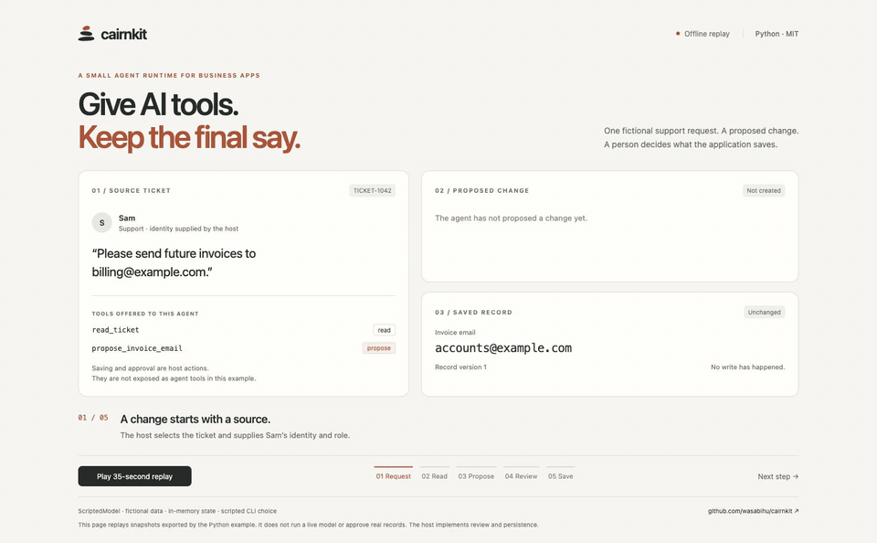

# cairnkit

[](https://github.com/wasabihu/cairnkit/actions/workflows/ci.yml)
[](LICENSE)


**A small agent runtime for business applications.** Give an agent useful tools while
keeping identity, permissions and persistence in your application. Use proposal tools
and a host-controlled review step when a person should decide what gets saved.

A cairn is a pile of stones that marks a trail so the next walker can follow it. cairnkit
does the same for agents: approved memory, searchable history and curated skills that the
next conversation builds on.

[中文说明](README.zh-CN.md)

## See the approval boundary

A fictional support ticket asks to change an invoice email. The agent reads it and
creates a draft. The saved record changes only after the host's reviewer approves it.
Rejecting the draft leaves the record untouched.



[Watch the 35-second walkthrough](docs/assets/cairnkit-approval-demo.mp4) ·
[Run the example and choose approve or reject](docs/approval-demo.md)

```bash
git clone https://github.com/wasabihu/cairnkit.git
cd cairnkit
uv run python examples/approval.py
```

**Offline, fictional data, no API key.** The model uses predetermined `ScriptedModel`
responses. The video replays snapshots from a real execution of that example, including
a scripted approval choice. It demonstrates the host integration, not model quality.
The in-memory review function is example application code, not a built-in approval service.

## Why another agent runtime

In a business application, several people may share records, each with different roles.
The application needs to retain control over which tools an agent can use and when a
proposed change becomes a saved record. cairnkit provides building blocks for that:

- **Identity comes from the host, never from the model.** Tools receive the signed-in
  person, their roles and the record being worked on in a `ToolContext`.
- **Make changes reviewable.** Tools declare an access level (`read`, `propose`, `write`)
  and allowed roles. Your proposal handler creates drafts; your application implements
  approval and persistence. The access label alone does not enforce human review.
- **Memory with guard rails.** Add / patch / remove edits located by quoted text, size
  limits, prompt-injection scanning and frozen snapshots, ported from Hermes Agent.
- **Compact long conversations.** A port of Hermes Agent's context compression:
  incremental structured summaries, real token anchors, cooldowns and verbatim user quotes.
- **Small.** The core depends only on the standard library and `httpx`. No web framework,
  no database, no vector store: storage and permissions stay in your application. The
  optional `knowledge` module adds document search on SQLite (standard library) and,
  if you want it, local vector search; the database file is still yours.

### How cairnkit compares

| Dimension | cairnkit | Hermes Agent | PydanticAI | LangGraph |
| --- | --- | --- | --- | --- |
| Primary target | Multi-user business web backends | Personal CLI & multi-platform assistant | General typed Python agent SDK | Graph-based workflow orchestration |
| Identity & scope | Host-injected `ToolContext` (user, roles, record scope) | Single local operator & workspace | App dependency injection (`RunContext`) | Custom state schema per graph |
| Write review boundary | Built-in `propose` access tier + host approval/version check | Local confirmations & sandbox controls | Custom tool wrappers / Deferred tools | Interrupt / breakpoint nodes |
| Memory & long context | Hermes snapshot, compaction, archival projection & bounded consolidation | Built-in `MEMORY.md`, files & session store | Message history processors | Checkpointers & store interfaces |
| Core dependencies | `stdlib` + `httpx` | Full CLI/gateway agent suite | `pydantic`, model SDKs, etc. | Graph runtime & LangChain Core |

## What is inside

| Area                 | Module                       | What it does                                                                                                   |
| -------------------- | ---------------------------- | -------------------------------------------------------------------------------------------------------------- |
| Agent loop           | `loop.py`                    | Model → tools → model, streaming, a forced plain answer when the step budget runs out                          |
| Tools                | `tools.py`                   | Schema, handler, access level, allowed roles; identity is injected, never taken from the model                 |
| Loop protection      | `guardrails.py`              | Warns or stops on repeated failing calls and identical results                                                 |
| System prompt        | `prompt.py`                  | Stable / context / volatile layers, assembled once per conversation for prompt caching                         |
| Memory               | `memory.py`, `memory_ops.py`, `memory_layers.py`, `memory_archive.py`, `memory_consolidation.py` | Bounded snapshots, write screening, ordinal layers, archive projections, and bounded consolidation ([design](docs/memory-design.md)) |
| History search       | `search.py`                  | One tool, four modes (search, read, context, browse); no model calls                                           |
| Skills               | `skills.py`                  | `SKILL.md` folders, shown on demand, scanned for injection when loaded                                         |
| Context compression  | `compression.py`             | Four-phase compaction with incremental summaries and per-conversation `CompressionState`                       |
| Background review    | `review.py`                  | After a turn, a forked agent decides whether anything should be remembered                                     |
| Delegation           | `delegate.py`                | Hand a focused task to a specialist agent and get back only its answer (one level deep)                        |
| Skill curation       | `curator.py`                 | Marks unused skills stale, suggests archives and merges; returns a plan, you decide                            |
| Injection scanning   | `security.py`                | Prompt injection, hidden characters and exfiltration patterns                                                  |
| Titles               | `titles.py`                  | Instant title, upgraded by a small model; never overrides a title the user typed                               |
| Models               | `llm/`                       | OpenAI-compatible client (streaming), OpenRouter, error classification, fallback chain, offline scripted model |
| Cost                 | `pricing.py`                 | Uses the provider's reported cost, otherwise a price table                                                     |
| Agent definitions    | `agents.py`                  | One folder per agent: `agent.toml` + `SOUL.md`                                                                 |
| Documents (optional) | `documents.py`               | PDF, Word, Excel and text to Markdown, with size and zip-bomb limits                                           |
| Knowledge (optional) | `knowledge/`                 | Searchable documents in SQLite: chunks by heading, English and Chinese keyword search, optional local vectors, scope filters, retrieval evaluation ([design](docs/knowledge-design.md)) |

## Install

```bash
pip install cairnkit
# or
uv add cairnkit
# with document reading (adds pypdf and openpyxl):
pip install "cairnkit[documents]"   # or: uv add "cairnkit[documents]"
# with vector search for the knowledge module (adds sqlite-vec and fastembed):
pip install "cairnkit[vectors]"
```

Python 3.12 or newer.

## Quick start

An agent is a folder:

```
agents/
  greeter/
    agent.toml
    SOUL.md
```

```toml
# agents/greeter/agent.toml
description = "Answers questions about opening hours."
model = "default"          # a name your application maps to a model
tools = ["opening_hours"]  # the only tools this agent may use
skills = []                # optional: skills from a skills/ folder
max_iterations = 4
temperature = 0.2
```

`SOUL.md` holds the persona and rules; it goes into the stable layer of the system prompt.

```python
from cairnkit import Agent, ToolContext, ToolRegistry, load_agents, openrouter, tool_result

tools = ToolRegistry()

@tools.tool(name="opening_hours", description="Opening hours for a weekday.",
            parameters={"type": "object", "properties": {"day": {"type": "string"}},
                        "required": ["day"]})
def opening_hours(args, ctx):
    return tool_result(day=args["day"], hours="7am-7pm")

specs = load_agents("agents")
agent = Agent(specs["greeter"], model=openrouter("openai/gpt-4.1-mini", api_key="..."),
              tools=tools)
result = await agent.run("When do you open on Sunday?", ToolContext(principal={"id": "u1"}))
print(result.text)
```

Runnable examples, no API key needed:

| Example                                                | Shows                                                      |
| ------------------------------------------------------ | ---------------------------------------------------------- |
| [examples/minimal.py](examples/minimal.py)             | The smallest complete agent with one tool                  |
| [examples/approval.py](examples/approval.py)           | Read a ticket, propose a change, approve or reject in the host |
| [examples/web_approval.py](examples/web_approval.py)   | Minimal HTTP/ASGI + SQLite + SSE approval flow with 403/409/200 checks |
| [examples/zero_call_memory.py](examples/zero_call_memory.py) | Zero-call screening, ordinal layering, archive projection, and overflow merge |
| [examples/read_document.py](examples/read_document.py) | Reading a PDF, Word or Excel file into Markdown            |
| [examples/knowledge.py](examples/knowledge.py)         | Search a fictional English and Chinese handbook and print the retrieval report (`--vectors` adds local embeddings) |
| [examples/verify_citations.py](examples/verify_citations.py) | A read tool that checks a draft's DOIs and PMIDs with [claimcite](https://github.com/wasabihu/claimcite) before review (needs network: `uv run --with claimcite python examples/verify_citations.py`) |

## Rules worth keeping

- **Identity is not the model's to decide.** Put the user and the record in `ToolContext`.
- **Assemble the system prompt once per conversation.** Pass `RunResult.system_prompt` back
  as `run(system_prompt=...)` on later turns so the provider's prompt cache keeps working.
- **Prefer `access="propose"`** for anything that changes data, and let a person approve.
- **Test offline** with `ScriptedModel`; automated tests should never call a real model.
- **Text from users, files and tools is data.** Keep it out of the system prompt.

## Memory that scales: snapshots, archives and consolidation

```python
from cairnkit.memory_consolidation import consolidate_memory

result = await consolidate_memory(
    model,
    entries,
    pending_operations,
    limit=12000,
    target_chars=8000,
    compact_entries=lossless_prepass,
    validate=validate_grounding,
)
if result.plan is not None:
    # Host must atomically compare the original snapshot, then commit and audit.
    commit_if_unchanged(entries, result.plan)
```

cairnkit separates host storage from bounded in-prompt working state so ordinary turns stay fast
and overflow stays auditable:

- **Frozen snapshots & write screening.** `render_snapshot` packs prioritized `MemoryItem` rows
  under a fixed character/item ceiling (skipping prompt injections and duplicate IDs) so
  mid-conversation writes never invalidate provider prompt caches.
- **Zero-call steady state.** Host-extracted writes go through `screen_memory_write` and
  `plan_operations` directly; adding `layer_facts` + `compact_entries` resolves lossless
  normalization and same-fact deduplication with `attempts=0` when the result fits `limit`.
- **Searchable archive without data loss.** `project_archive` turns canonical host records into
  detailed recent/protected items plus grouped topic summaries (`WorkingMemory`) while keeping
  every original record intact for scoped retrieval.
- **Bounded overflow consolidation.** When distinct facts still exceed `limit` (and
  `minimum_chars` does not prove `capacity_unreachable`), `consolidate_memory` runs up to 3
  structured selection proposals with `render_group`, 95% over-removal guards, and host
  `validate` checks before returning an atomic `MemoryPlan`.

Full contracts, edge-case guards, and archive invariants live in
[docs/memory-design.md](docs/memory-design.md). See
[examples/zero_call_memory.py](examples/zero_call_memory.py) for an offline runnable walkthrough.

## Reading documents (optional)

```python
from cairnkit.documents import DocumentError, Limits, extract_text

try:
    doc = extract_text(data, "price-list.xlsx", limits=Limits(max_chars=40_000))
except DocumentError as exc:
    exc.code  # too_large, empty, unsupported, old_format, image, encrypted, no_text, unreadable, needs_extra
else:
    doc.text, doc.kind, doc.parts, doc.truncated, doc.warnings
```

- **Output** is Markdown. Word keeps headings, lists and tables; Excel becomes one table per
  visible sheet (dates as `2026-11-07`); PDF text is marked `[Page N]`.
- **The format is judged by content**, not only the file name. Old `.doc`/`.xls`, pictures
  and scanned PDFs get their own error codes so your UI can explain what to do.
- **Limits** on file size, PDF pages, Excel rows and unzipped size. Only text is read;
  macros and formulas never run.
- **Replaceable**: `register_extractor("pdf", fn)` swaps in another reader (MarkItDown,
  Docling, an OCR service) without changing callers.

## Relationship to Hermes Agent

Many mechanisms and algorithms are ported from
[Hermes Agent](https://github.com/NousResearch/hermes-agent) v0.23.0 (MIT, Nous Research):
the prompt layers, the tool loop, memory editing rules, history search, skills, context
compression, background review, curation and delegation. Every ported file names its
Hermes source in its header. Hermes is a personal assistant with files, terminals and
dozens of platforms; cairnkit keeps the algorithms and replaces storage, configuration and
permissions so they fit a multi-user web application. See
[docs/hermes-porting.md](docs/hermes-porting.md) for the map and
[docs/upgrading-hermes.md](docs/upgrading-hermes.md) for following new Hermes releases.
cairnkit is not affiliated with or endorsed by Nous Research.

## Versioning

`MAJOR.MINOR.PATCH`. Before 1.0:

- **Patch** (0.3.0 → 0.3.1): fixes, tests and docs; upgrade freely.
- **Minor** (0.3 → 0.4): new features, Hermes updates, or anything that needs changes in
  your code. [CHANGELOG.md](CHANGELOG.md) says what to change.

## Development

```bash
uv sync --all-extras
uv run pytest -q && uv run ruff check . && uv run ruff format --check .
```

See [CONTRIBUTING.md](CONTRIBUTING.md). Security reports: [SECURITY.md](SECURITY.md).

## License

MIT, see [LICENSE](LICENSE). Ported Hermes Agent code keeps its MIT notice in
[NOTICE.md](NOTICE.md).
