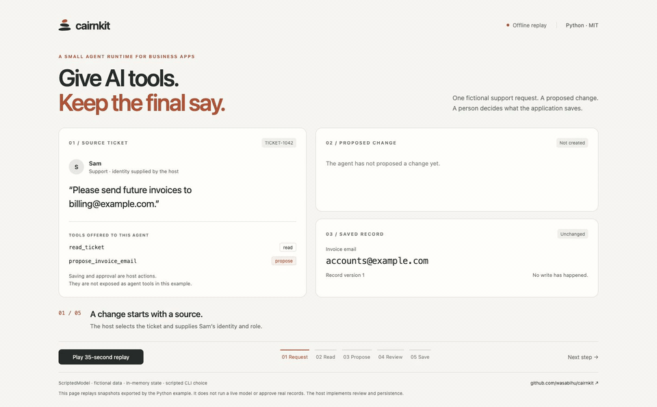

# cairnkit

**给业务系统用的小型智能体运行层。** 给智能体提供工具，身份、权限和数据保存留在你的应用里。需要人工审核时，用提议工具生成草稿，再由应用中的审核流程决定是否写入。

cairn 是山路上堆起来的石头路标，后来的人沿着它走。cairnkit 给智能体做同样的事：审核过的记忆、可检索的历史、整理好的技能，下一次对话接着用。

[English](README.md)

## 先看一个完整流程

一张虚构工单要求修改账单邮箱。智能体读取工单、提出修改；原记录保持不变，直到应用中的审核人批准。拒绝草稿则不修改原记录。



[35 秒演示视频](docs/assets/cairnkit-approval-demo.mp4) · [运行步骤和边界说明](docs/approval-demo.md)

```bash
git clone https://github.com/wasabihu/cairnkit.git
cd cairnkit
uv run python examples/approval.py
```

终端会询问 `approve` 或 `reject`。**离线运行、虚构数据、不需要 API key。** 模型使用预设的 `ScriptedModel` 响应；视频回放的是示例实际运行导出的快照，批准选择在录制时由命令行指定。它展示应用如何接入审批，不代表模型能力测试。内存中的审批逻辑是示例代码，不是库自带的审批服务。

## 和其它框架有什么不同

- **身份来自应用，不来自模型。** 工具从 `ToolContext` 拿到当前登录的人、他的岗位、正在处理的记录。
- **让修改可审核。** 工具声明访问级别（`read` / `propose` / `write`）和可用岗位。提议工具的处理函数创建草稿，审批和最终保存由你的应用实现；仅声明访问级别不会自动强制人工审核。
- **有护栏的记忆。** 按原文定位的增 / 改 / 删、容量上限、注入扫描、会话内固定快照，移植自 Hermes Agent。
- **压缩长对话。** 移植 Hermes 的上下文压缩：增量结构化摘要、真实 token 锚点、失败冷却、保留用户原话。
- **小。** 核心只依赖标准库和 `httpx`；不带 Web 框架、数据库或向量库，存储和权限留在你的应用里。

模块清单、接入步骤和示例见 [英文 README](README.md)，代码示例两种语言通用。

## 安装

暂未发布到 PyPI，从 GitHub 固定版本标签安装：

```bash
uv add "cairnkit @ git+https://github.com/wasabihu/cairnkit@v0.4.1"
# 需要读取 PDF / Word / Excel 时：
uv add "cairnkit[documents] @ git+https://github.com/wasabihu/cairnkit@v0.4.1"
```

需要 Python 3.12 或更新版本。

## 几条规则

- **身份不由模型决定。** 把用户和记录放进 `ToolContext`。
- **系统提示一个会话只组装一次。** 后续轮次把 `RunResult.system_prompt` 传回 `run(system_prompt=...)`，保住服务商的提示缓存。
- **会改数据的工具优先用 `access="propose"`**，由人批准。
- **离线测试**用 `ScriptedModel`，自动化测试不调用真实模型。
- **用户、文件、工具返回的文字都是数据**，不要放进系统提示。

## 和 Hermes Agent 的关系

很多机制和算法移植自 [Hermes Agent](https://github.com/NousResearch/hermes-agent) v0.22.2（MIT，Nous Research），每个移植文件头部都写明了来源。Hermes 是带文件、终端和几十个平台的个人助手；cairnkit 保留算法，替换了存储、配置和权限三层，以适配多人使用的网站。对照表见 [docs/hermes-porting.md](docs/hermes-porting.md)。cairnkit 与 Nous Research 没有隶属或背书关系。

## 版本

1.0 之前：修订号（0.3.0 → 0.3.1）只修缺陷和文档，可直接升级；次版本（0.3 → 0.4）可能需要改代码，[CHANGELOG.md](CHANGELOG.md) 会写清楚怎么改。

## 许可证

MIT，见 [LICENSE](LICENSE)；移植的 Hermes 代码保留其 MIT 声明，见 [NOTICE.md](NOTICE.md)。
