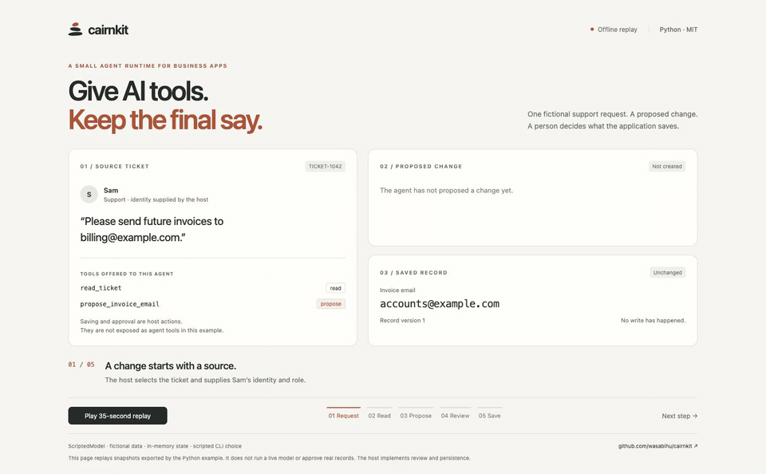

# cairnkit

[](https://github.com/wasabihu/cairnkit/actions/workflows/ci.yml)
[](LICENSE)


**给业务系统用的小型智能体运行层。** 给智能体提供工具，同时把身份、权限和数据持久化留在你的应用里。需要人工拍板时，让智能体调用提议工具生成草稿，再由应用的审核流程决定是否正式保存。

cairn 是山路上堆起来的石头路标，让后来的人沿着路走。cairnkit 为智能体做同样的事：审核过的记忆、可检索的历史、沉淀下来的技能，让下一次对话直接建立在前一次的基础上。

[English](README.md)

## 先看审批边界

一张虚构工单请求修改账单邮箱。智能体读取工单后创建草稿；原记录保持不变，直到应用里的审核人批准。拒绝草稿时，原记录完全不受影响。



[观看 35 秒演示视频](docs/assets/cairnkit-approval-demo.mp4) ·
[查看运行步骤与边界说明](docs/approval-demo.md)

```bash
git clone https://github.com/wasabihu/cairnkit.git
cd cairnkit
uv run python examples/approval.py
```

**全程离线、虚构数据、无需 API key。** 模型使用预设的 `ScriptedModel` 响应；视频回放的是该示例真实运行的导出快照（录制时在命令行脚本化传入 `approve`）。它演示的是宿主系统集成边界，而不是模型评测；示例代码里的内存审核函数仅作教学示范，不是内置鉴权或数据库服务。

## 为什么再做一个智能体运行层

在一个多人使用的业务系统里，不同岗位看到不同记录，权限边界也不能交给模型自己判断。应用需要牢牢握住两件事：**能用哪些工具**、**草稿什么时候变成真实记录**。cairnkit 为此提供这些基础积木：

- **身份来自宿主应用，而不是模型参数。** 工具通过 `ToolContext` 获取当前登录人、角色与作用域记录，不依赖模型自报身份。
- **让写操作可审核。** 每个工具声明访问级别（`read` / `propose` / `write`）和允许的角色。提议型工具只写草稿，最终审批和入库由你的业务代码负责；单独一个标签并不会替代应用层的审批逻辑。
- **有护栏的记忆。** 基于原文精准定位的 add / patch / remove 编辑、字符上限、提示注入扫描与会话内冻结快照，核心机制移植自 Hermes Agent。
- **长对话可压缩。** 移植自 Hermes Agent 的四阶段上下文压缩：增量结构化摘要、真实 token 锚点、冷却窗口与保留用户原话。
- **足够小巧。** 核心只依赖 Python 标准库和 `httpx`，不捆绑 Web 框架、数据库或向量库。可选的 `knowledge` 模块基于标准库 SQLite 提供中英文检索（支持按需开启本地向量检索），数据库文件依然完全属于你的应用。

### 与常见方案的定位对比

| 维度 | cairnkit | Hermes Agent | PydanticAI | LangGraph |
| --- | --- | --- | --- | --- |
| 适用场景 | 多用户业务型 Web 后端 | 个人命令行与多平台助手 | 通用强类型 Python 智能体框架 | 状态图工作流编排 |
| 身份与作用域 | 宿主注入 `ToolContext`（用户、角色、记录范围） | 单一本地操作者与工作区 | 应用依赖注入（`RunContext`） | 按图自定义状态 Schema |
| 写入审核边界 | 内置 `propose` 层级 + 宿主审批与版本锁示例 | 本地确认与沙箱控制 | 自定义工具包装 / Deferred tools | Interrupt / 断点节点 |
| 记忆与长上下文 | Hermes 快照、压缩、归档投影与有界整理 | 内置 `MEMORY.md`、文件与会话库 | 消息历史处理器 | Checkpointer 与 Store 接口 |
| 核心依赖 | 标准库 + `httpx` | 完整 CLI/网关智能体套件 | `pydantic`、各模型 SDK 等 | 图运行时与 LangChain Core |

## 模块一览

| 领域 | 模块 | 作用 |
| --- | --- | --- |
| 智能体循环 | `loop.py` | 模型 → 工具 → 模型流式循环，耗尽步数预算时强制兜底纯文本回答 |
| 工具系统 | `tools.py` | 参数 Schema、执行器、访问级别与角色限制；由宿主注入身份，不信任模型传参 |
| 循环护栏 | `guardrails.py` | 检测重复失败调用与完全重复结果，及时告警或中止 |
| 系统提示词 | `prompt.py` | `stable / context / volatile` 三层结构，按会话组装一次以命中缓存 |
| 记忆系统 | `memory.py`, `memory_ops.py`, `memory_layers.py`, `memory_archive.py`, `memory_consolidation.py` | 有界快照、写入注入扫描、序数分层、纯归档投影与有界超限整理（[设计文档](docs/memory-design.md)） |
| 历史检索 | `search.py` | 单工具四模式（`search`、`read`、`context`、`browse`），零额外模型调用 |
| 技能加载 | `skills.py` | `SKILL.md` 技能目录，按需展示并在加载时做注入扫描 |
| 上下文压缩 | `compression.py` | 四阶段增量摘要与逐会话 `CompressionState` |
| 后台记忆复盘 | `review.py` | 对话结束后派分身核对哪些新事实值得写入记忆 |
| 子任务委派 | `delegate.py` | 将聚焦子任务委派给专职子智能体并只取回其回答（单层委派） |
| 技能维护建议 | `curator.py` | 标记久未使用的技能、建议归档与合并（只给方案，你来决定） |
| 安全与注入扫描 | `security.py` | 提示注入模式、零宽隐藏字符与外泄特征检测 |
| 会话标题 | `titles.py` | 本地秒出标题，再用小模型升级；绝不覆盖用户手改标题 |
| 模型适配 | `llm/` | OpenAI 兼容客户端（严格流式校验）、OpenRouter、错误分级、降级链与离线 `ScriptedModel` |
| 成本估算 | `pricing.py` | 优先采用服务端返回成本，否则按价格表估算 |
| 智能体定义 | `agents.py` | 一个目录定义一个智能体：`agent.toml` + `SOUL.md` |
| 文档解析（可选） | `documents.py` | PDF / Word / Excel 转 Markdown，带体积与 zip-bomb 防护 |
| 知识库（可选） | `knowledge/` | SQLite 分块检索（按标题切分、中英文分词、可选本地向量、范围过滤与离线评测，详见 [设计文档](docs/knowledge-design.md)） |

## 安装

```bash
pip install cairnkit
# 或者
uv add cairnkit
# 需要读取 PDF / Word / Excel 时：
pip install "cairnkit[documents]"   # 或：uv add "cairnkit[documents]"
# 知识库需要本地向量检索时（增加 sqlite-vec 和 fastembed）：
pip install "cairnkit[vectors]"
```

需要 Python 3.12 或更高版本。

## 快速开始

一个目录就是一个智能体：

```
agents/
  greeter/
    agent.toml
    SOUL.md
```

```toml
# agents/greeter/agent.toml
description = "Answers questions about opening hours."
model = "default"          # 由你的应用映射到真实模型名
tools = ["opening_hours"]  # 该智能体仅允许调用这些工具
skills = []                # 可选：来自 skills/ 目录的技能名
max_iterations = 4
temperature = 0.2
```

`SOUL.md` 写固定人设与规则，会自动放进系统提示词的 `stable` 层：

```python
from cairnkit import Agent, ToolContext, ToolRegistry, load_agents, openrouter, tool_result

tools = ToolRegistry()

@tools.tool(name="opening_hours", description="Opening hours for a weekday.",
            parameters={"type": "object", "properties": {"day": {"type": "string"}},
                        "required": ["day"]})
def opening_hours(args, ctx):
    return tool_result(day=args["day"], hours="7am-7pm")

specs = load_agents("agents")
agent = Agent(specs["greeter"], model=openrouter("openai/gpt-4.1-mini", api_key="..."),
              tools=tools)
result = await agent.run("When do you open on Sunday?", ToolContext(principal={"id": "u1"}))
print(result.text)
```

无需 API Key 即可直接运行的可运行示例：

| 示例 | 演示内容 |
| --- | --- |
| [examples/minimal.py](examples/minimal.py) | 最精简的单工具智能体完整链路 |
| [examples/approval.py](examples/approval.py) | 读取工单、生成修改草稿、在宿主中批准或拒绝 |
| [examples/web_approval.py](examples/web_approval.py) | 标准库 ASGI + SQLite + SSE 审批闭环（含 `403`/`409`/`200` 校验） |
| [examples/zero_call_memory.py](examples/zero_call_memory.py) | 零模型调用写入筛选、序数分层、纯归档投影与真超限有界合并 |
| [examples/read_document.py](examples/read_document.py) | 读取 PDF / Word / Excel 为 Markdown |
| [examples/knowledge.py](examples/knowledge.py) | 检索中英文虚构手册并打印评测报告（加 `--vectors` 启用本地向量） |
| [examples/verify_citations.py](examples/verify_citations.py) | 在人工审核前用 [claimcite](https://github.com/wasabihu/claimcite) 核对草稿里的 DOI 与 PMID（需联网：`uv run --with claimcite python examples/verify_citations.py`） |

## 几条值得守住的规则

- **身份不由模型决定。** 始终通过 `ToolContext` 传入操作者和目标记录。
- **系统提示一个会话只组装一次。** 后续轮次将首轮的 `RunResult.system_prompt` 传给 `run(system_prompt=...)`，保住模型服务商的提示缓存。
- **涉及写数据的操作优先声明 `access="propose"`**，交给应用层和人做最后确认。
- **自动化测试必须离线**，使用 `ScriptedModel` 代替真实网络模型调用。
- **用户、文件和工具返回的文字都只是数据**，不要放进系统提示词里。

## 可扩展的记忆：快照、分层归档与超限整理

```python
from cairnkit.memory_consolidation import consolidate_memory

result = await consolidate_memory(
    model,
    entries,
    pending_operations,
    limit=12000,
    target_chars=8000,
    compact_entries=lossless_prepass,
    validate=validate_grounding,
)
if result.plan is not None:
    # 宿主必须先原子比对原始快照未漂移，再提交写入与审计日志。
    commit_if_unchanged(entries, result.plan)
```

cairnkit 把宿主存储与提示词工作视图解耦，让常规对话零额外成本、真正超限时才受控压缩：

- **冻结快照与写入安全扫描。** `render_snapshot` 按宿主优先级把 `MemoryItem` 装入固定字符/条数上限（自动跳过含注入特征或重复 ID 的条目），确保会话中途新增记忆也不会打碎提示缓存。
- **常规路径零模型调用。** 宿主明确提取到的事实直接经 `screen_memory_write` + `plan_operations` 校验；传入 `layer_facts` 与无损预处理 `compact_entries` 后，只要压缩结果落回 `limit` 以内，即以 `attempts=0`（`precompacted=True`）直接返回。
- **保留原始事实的归档投影。** `project_archive` 把规范存储投影为「近期/受保护明细 + 同主题分组摘要（`WorkingMemory`）」，不删不改原表记录，方便宿主继续按权限精准检索。
- **严格有界的超限整理。** 只有当无损预处理后仍超限（且宿主 `minimum_chars` 未判定为 `capacity_unreachable`）时，`consolidate_memory` 才会发起最多 3 次选择式合并建议，结合 `render_group`、95% 过度删除拦截与宿主 `validate` 返回原子 `MemoryPlan`。

完整契约、边界护栏与归档不变量见 [docs/memory-design.md](docs/memory-design.md)，离线端到端示例见 [examples/zero_call_memory.py](examples/zero_call_memory.py)。

## 文档读取（可选）

```python
from cairnkit.documents import DocumentError, Limits, extract_text

try:
    doc = extract_text(data, "price-list.xlsx", limits=Limits(max_chars=40_000))
except DocumentError as exc:
    exc.code  # too_large, empty, unsupported, old_format, image, encrypted, no_text, unreadable, needs_extra
else:
    doc.text, doc.kind, doc.parts, doc.truncated, doc.warnings
```

- **统一输出 Markdown。** Word 保留标题、列表与表格；Excel 每个可见工作表转为一张表（日期规范为 `2026-11-07`）；PDF 按 `[Page N]` 标记页码。
- **按文件内容而非扩展名识别。** 老旧 `.doc` / `.xls`、纯图片和扫描版 PDF 会给出清晰错误码，方便前端提示用户处理方式。
- **内置安全与体积护栏。** 限制文件大小、PDF 页数、Excel 行数与解压后大小，只读取文本，绝不执行宏或公式。
- **可随时替换解析器。** 调用 `register_extractor("pdf", fn)` 即可无痛接入 MarkItDown、Docling 或自有 OCR 服务。

## 和 Hermes Agent 的关系

cairnkit 的许多核心机制与算法移植自 [Hermes Agent](https://github.com/NousResearch/hermes-agent) v0.23.0（MIT 协议，Nous Research）：提示词分层、工具循环、记忆编辑规则、历史检索、技能系统、上下文压缩、后台复盘、技能整理与子任务委派，并在每个移植文件头部写明了具体来源。Hermes 是面向本地文件、终端与几十个聊天平台的个人助手；cairnkit 保留其算法内核，替换掉存储、配置与权限三层，使其适合多用户 Web 业务系统。对照清单见 [docs/hermes-porting.md](docs/hermes-porting.md)，跟进上游版本方法见 [docs/upgrading-hermes.md](docs/upgrading-hermes.md)。cairnkit 与 Nous Research 没有隶属或背书关系。

## 版本规则

遵循 `MAJOR.MINOR.PATCH`。在 `1.0.0` 之前：

- **Patch**（`0.3.0 → 0.3.1`）：缺陷修复、测试与文档更新，可直接平滑升级。
- **Minor**（`0.3 → 0.4`）：新增能力、同步上游 Hermes 更新或可能影响调用方式的变更，具体迁移说明见 [CHANGELOG.md](CHANGELOG.md)。

## 本地开发

```bash
uv sync --all-extras
uv run pytest -q && uv run ruff check . && uv run ruff format --check .
```

贡献指南见 [CONTRIBUTING.md](CONTRIBUTING.md)，安全漏洞报告方式见 [SECURITY.md](SECURITY.md)。

## 许可证

MIT 许可证，详见 [LICENSE](LICENSE)。源自 Hermes Agent 的代码在 [NOTICE.md](NOTICE.md) 中完整保留其 MIT 版权声明。
